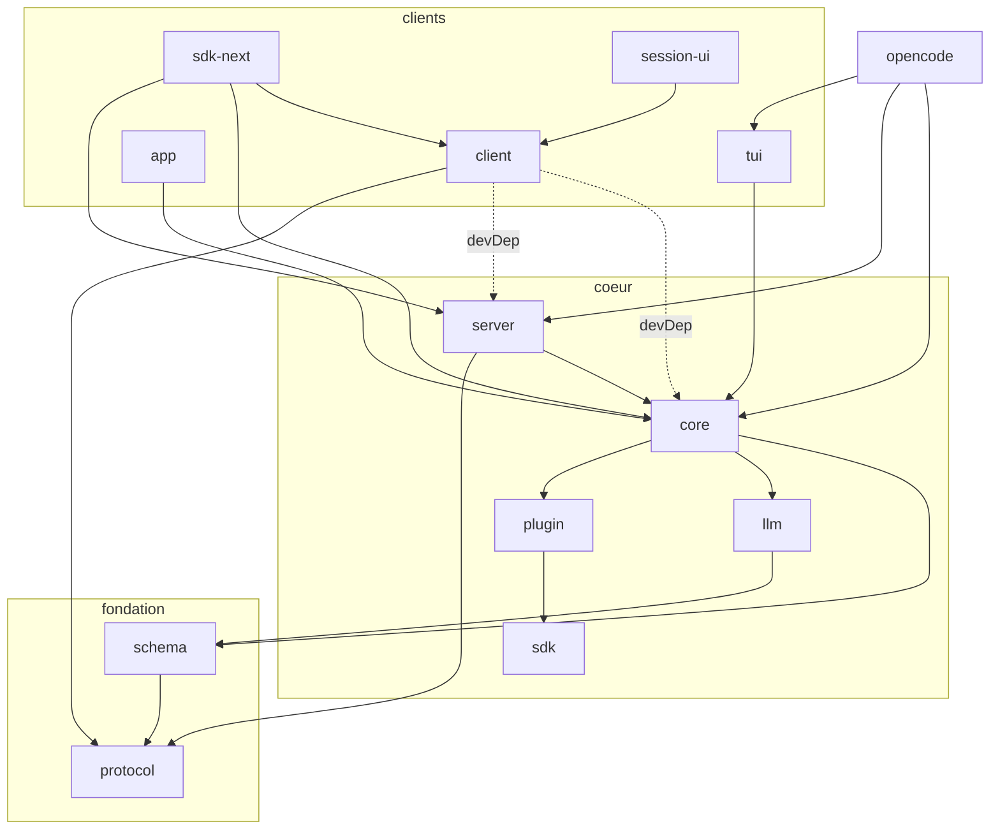

# Audit structurel, approfondi et complet — OpenCode Asse

> **Périmètre** : dépôt `OpenCodeAsse` (fork de `anomalyco/opencode`), branche courante `security-hardening`.
> **État audité** : commit `ab936fb69f` (« docs: classify SessionV2.wait as a deliberate v2 stub »).
> **Méthode** : inspection directe du code et des manifestes (grep/find/jq/python), exécution réelle des suites de tests orphelines, dry-run Turbo, inventaire des workflows GitHub. Chaque constat est prouvé par un chemin et un numéro de ligne. Les hypothèses non vérifiables sont marquées **[H]**.
> **Limites** : le typecheck global n'a pas été exécuté ; la recherche web n'était pas disponible ; les échecs de tests orphelins ont été obtenus avec le bun local (1.3.14, conforme au `packageManager`), un seul cas (desktop) est clairement lié à l'environnement.

---

## 0. Résumé exécutif

**Verdict.** L'architecture est saine et le travail de la branche `security-hardening` est réel et bien testé _là où il vit_ — mais le système de construction ne fait pas tourner plus des deux tiers des tests du dépôt, et 27 tests déjà écrits échouent aujourd'hui sans que personne ne le voie. Le problème dominant de ce dépôt n'est pas la qualité du code : c'est l'écart entre ce qui est écrit et ce qui est exécuté.

| #   | Sévérité     | Constat                                                                                                   | Preuve                                                                                   |
| --- | ------------ | --------------------------------------------------------------------------------------------------------- | ---------------------------------------------------------------------------------------- |
| 1   | **CRITIQUE** | La CI n'exécute que **6 suites de tests sur 21** : 137 des 759 fichiers de test (18 %) ne tournent jamais | `turbo.json:11-33` + `.github/workflows/test.yml:68`                                     |
| 2   | **CRITIQUE** | 27 tests échouent déjà dans 4 paquets jamais testés en CI                                                 | `packages/schema` (2), `sdk-next` (3), `enterprise` (17), `stats/core` (5)               |
| 3   | MAJEUR       | Aucun lint ni format en CI ni en hook : `.oxlintrc.json` est inert                                        | aucun `oxlint`/`prettier` dans `.github/`, `.husky/pre-push` ne fait que `bun typecheck` |
| 4   | MAJEUR       | Pas de scan de secrets en CI alors que `.gitleaksignore` existe                                           | aucun workflow gitleaks ; le fichier d'ignore ne sert à rien                             |
| 5   | MAJEUR       | Double runtime v1/v2 : 16 domaines dupliqués, ~15 179 lignes en double                                    | tableau §3.2                                                                             |
| 6   | MAJEUR       | Divergence : 38 commits non mergés, 5 commits de retard sur `origin/dev`                                  | `git rev-list --left-right --count origin/dev...HEAD` → `5  38`                          |
| 7   | MAJEUR       | Artefacts de travail non gitignorés (≈ 300 Ko de docs + 64 Mo de node_modules dans `.opencode/`)          | `git status --porcelain` : 9 entrées non suivies                                         |
| 8   | MAJEUR       | 20 dépendances en range flottant hors catalogue, dont `typescript ~5.6.2` (desktop) vs catalogue `5.8.2`  | `packages/desktop/package.json:56`                                                       |
| 9   | Mineur       | 19 patches de dépendances critiques (8× ai-sdk, MCP SDK, effect…)                                         | `package.json` `patchedDependencies`                                                     |
| 10  | Mineur       | `typecheck.yml` ne couvre que les PR vers `dev`                                                           | `.github/workflows/typecheck.yml:7`                                                      |
| 11  | Mineur       | 932 occurrences `: any`/`as any`, 98 `@ts-ignore`/`@ts-expect-error`                                      | comptage §6                                                                              |

**Points forts conservés** : respect strict des frontières de couches documentées, zéro cycle de dépendances, actions GitHub épinglées par SHA, supply-chain bun durcie (`exact = true` + `minimumReleaseAge` 3 jours), invariants Session V2 réellement respectés dans le code, sous-agents avec allowlist de permissions effective.

---

## 1. Cartographie du dépôt

### 1.1 Chiffres

- **655 411 lignes** de source TS/TSX (3 309 fichiers, hors code généré, node_modules, dist).
- **759 fichiers de test** (18 % du total).
- **33 entrées** sous `packages/`, dont **27 vrais paquets workspace** (6 dossiers parents ou non-paquets : `console`, `stats`, `sdk`, `identity`, `docs`, `containers`).
- `node_modules` : **2,6 Go**.
- Répartition : `opencode` 181 906 lignes, `app` 171 463, `core` 76 048, `console/app` 37 777, `ui` 34 101, `tui` 32 110, `session-ui` 21 529, `llm` 20 631.

### 1.2 Graphe des couches (conforme à AG.md)



Vérification scriptée des 22 arêtes workspace : **toutes les arêtes runtime respectent la règle** « Schema ← Core/Protocol ← Server ; Client ne dépend de Core/Server qu'en devDependencies » (`packages/client/package.json` : `@opencode-ai/core` et `@opencode-ai/server` sont en `devDependencies`). **Aucun cycle** inter-packages, ni runtime ni dev. _(Constat positif : la règle de AG.md est vraie, pas seulement proclamée.)_

Anomalie structurelle légère : `packages/identity` (6 icônes, 0 TypeScript), `packages/docs` (contenu documentation), `packages/containers` (Dockerfiles) ne sont pas des paquets mais vivent sous `packages/` — confusion de namespace, pas de bug.

---

## 2. Chaîne de construction et CI

### 2.1 Le trou n°1 : les tests orphelins

`.github/workflows/test.yml:68` lance `bun turbo test`. Or `turbo.json:11-33` ne déclare que **6 tâches** `#test`. Preuve empirique (dry-run) :

```
bun turbo run test --dry=json → 22 tâches planifiées, dont exactement 6 de test :
  app, core, function, session-ui, ui, opencode
```

Les 9 paquets qui possèdent un `script test` mais **aucune tâche Turbo** sont silencieusement ignorés : `client`, `codemode`, `effect-drizzle`, `http-recorder`, `httpapi-codegen`, `llm`, `sdk-next`, `sdk`, `tui`. Dix autres paquets ont des tests **sans même un script** : `schema`, `protocol`, `desktop`, `enterprise`, `cli`, `console/*`, `stats/*`.

**Total : 137 fichiers de test sur 759 (18 %) jamais exécutés par la CI.**

### 2.2 Ce que révèle l'exécution réelle des suites orphelines

Toutes les suites orphelines ont été lancées localement (bun 1.3.14) :

| Paquet                                                                                                                                                                             | Fichiers de test | Tests | Résultat                                                                               |
| ---------------------------------------------------------------------------------------------------------------------------------------------------------------------------------- | ---------------- | ----- | -------------------------------------------------------------------------------------- |
| `schema`                                                                                                                                                                           | 6                | 15    | **2 échecs** — « public event manifest > owns the complete public event surface » (2×) |
| `sdk-next`                                                                                                                                                                         | 2                | 5     | **3 échecs** — Location-owned runner events, embedded hosts, Layer service             |
| `enterprise`                                                                                                                                                                       | 2                | 18    | **17 échecs** — toute la suite `core.share`                                            |
| `stats/core`                                                                                                                                                                       | 4                | 40    | **5 échecs** — « reads all N aggregate rows »                                          |
| `desktop`                                                                                                                                                                          | 15               | 72    | 1 erreur d'environnement (`No such built-in module: node:sqlite`)                      |
| `protocol`, `client`, `codemode`, `httpapi-codegen`, `effect-drizzle`, `http-recorder`, `sdk`, `cli`, `console/core`, `console/app`, `stats/app`, `console/function`, `llm`, `tui` | —                | —     | 0 échec                                                                                |

**Interprétation.** 27 tests en échec dans 4 paquets : ce sont des régressions silencieuses — le code a bougé, les tests n'ont pas suivi, et rien ne le signale. Le cas `schema` est le plus probant : son test « owns the complete public event surface » existe précisément pour empêcher ce genre de dérive.

### 2.3 Inventaire des workflows (36 fichiers)

| Workflow                                                                                      | Déclencheurs                             | Permissions                           | Observation                                                              |
| --------------------------------------------------------------------------------------------- | ---------------------------------------- | ------------------------------------- | ------------------------------------------------------------------------ |
| `test.yml`                                                                                    | push `dev`, PR (toutes branches)         | `contents: read, checks: write`       | lance `bun turbo test` (cf. §2.1) + `check:generated` + exercice httpapi |
| `typecheck.yml`                                                                               | push `dev`, **PR vers `dev` uniquement** | (défaut)                              | `bun typecheck` = 36 tâches Turbo, couverture quasi complète             |
| `generate.yml`                                                                                | push `dev`                               | `contents: write`                     | `git add -A` + commit + push `--no-verify`                               |
| `docs-locale-sync.yml`                                                                        | push                                     | (défaut)                              | pousse des commits (token App)                                           |
| `models-snapshot.yml`, `nix-hashes.yml`                                                       | push/schedule                            | `contents: write`                     |                                                                          |
| `publish.yml`                                                                                 | push/workflow_dispatch                   | `id-token, contents, packages: write` | 8 jobs, signature macOS/Windows                                          |
| `pr-management.yml`, `pr-standards.yml`                                                       | `pull_request_target`                    | explicites dans le job                | pas de checkout du code PR → exposition limitée                          |
| `close-issues`, `triage`, `review`, `storybook`, `stats`, `deploy`, `containers`, `nix-eval`… | divers                                   | explicites ou défaut                  |                                                                          |

**Points positifs** : toutes les actions externes sont épinglées par SHA de commit (pas de tag flottant), permissions minimales déclarées sur les workflows sensibles.

**Lacunes :**

- **Aucun workflow lint/format**. `bun run lint` (oxlint, config type-aware) n'est appelé nulle part ; le hook `pre-push` (`.husky/pre-push`) ne fait qu'un `bun typecheck`. Le fichier `.oxlintrc.json` est donc décoratif.
- **Aucun scan de secrets en CI**. `.gitleaksignore` existe (4 entrées, toutes documentées comme fausses clés de test dans `packages/http-recorder/test/record-replay.test.ts`) mais aucun workflow n'appelle gitleaks : la configuration est morte.
- ~~`.github/workflows/test.yml:13` utilise `${{ case(...) }}` dans la clé de concurrence.~~ **RETIRÉ — fausse alerte.** `case(pred1, val1, pred2, val2, ..., default)` est bien une fonction d'expression GitHub Actions documentée (vérifié dans la référence officielle), et l'usage de `test.yml:13` est correct : `case(ref == 'refs/heads/dev', format(...), format(...))` renvoie la première valeur quand le prédicat est vrai, sinon la seconde. Aucun correctif nécessaire.
- Pas de seuil de couverture, pas de rapport de couverture publié.

---

## 3. Architecture : le runtime double v1/v2

### 3.1 Invariants de AG.md §« V2 Session Core » — vérifiés dans le code

| Invariant                                                                                                         | Statut       | Preuve                                                                                                                |
| ----------------------------------------------------------------------------------------------------------------- | ------------ | --------------------------------------------------------------------------------------------------------------------- |
| `SessionV2.prompt` écrit une ligne durable `session_input` avant `SessionExecution.wake`                          | ✅ respecté  | `packages/core/src/session.ts:362-385` : `SessionInput.admit` puis `execution.wake` sauf `resume: false`              |
| Admission séparée de l'exécution, promotion aux frontières sûres                                                  | ✅           | `packages/core/src/session/input.ts:41-116` (événement `PromptAdmitted` + projection)                                 |
| `SessionExecution` global, coordonné par `SessionRunCoordinator` (coalescence des wakeups, sessions concurrentes) | ✅           | `packages/core/src/session/run-coordinator.ts:81-92` (`wake` : `pendingWake` si occupé), `execution/local.ts:16-37`   |
| Un seul `llm.stream(request)` par tour provider                                                                   | ✅           | `packages/core/src/session/runner/llm.ts:250`, documenté lignes 64 et 85                                              |
| Pas de pont vers `SessionPrompt.loop(...)` depuis le cœur                                                         | ✅           | zéro référence à `SessionPrompt` dans `packages/core/src` (seul un commentaire historique : `runner/llm.ts:47`)       |
| Stubs assumés                                                                                                     | ✅ documenté | `session.ts:389-425` : `shell`, `skill`, `compact`, `wait` → `OperationUnavailableError` ; conforme à `APERCU.md:222` |

### 3.2 Le poids du double runtime

Comparaison des domaines présents **dans les deux arbres** `packages/core/src` et `packages/opencode/src` :

| Domaine                                   | core (lignes)       | opencode (lignes) |
| ----------------------------------------- | ------------------- | ----------------- |
| session                                   | 3 730               | 8 132             |
| tool                                      | 4 708               | 5 301             |
| plugin                                    | 2 957               | 6 094             |
| config                                    | 917                 | 2 082             |
| permission                                | 99                  | 387               |
| project                                   | 536                 | 1 226             |
| account                                   | 39                  | 759               |
| control-plane                             | 168                 | 1 351             |
| share                                     | 13                  | 429               |
| skill                                     | 289                 | 494               |
| effect / id / image / installation / util | —                   | —                 |
| **Total en double**                       | **≈ 15 179 lignes** |                   |

Deux systèmes de permission coexistent (`core/src/permission.ts` 332 lignes vs `opencode/src/permission/` 387 lignes), deux registres d'outils, deux implémentations de session. Le monolithe legacy `opencode/src/session/prompt.ts` (1 631 lignes) est toujours vivant, et `runner/llm.ts:46-47` porte une **checklist de migration non terminée** (« Implement the unchecked items in small reviewed slices »). Il n'existe aucun plan de décommissionnement versionné : le risque n'est pas le code dupliqué lui-même, mais la divergence silencieuse des deux logiques de permission et de promotion de messages.

### 3.3 Points forts de la branche `security-hardening` (38 commits)

- Permission réellement exigée pour les outils built-in auparavant non gardés, pour la dismissal/reset de l'observer, pour MCP par action (commits `e8b5653fc6`, `5883724621`, `34a5a1943e`).
- Sous-agents avec **allowlist effective**, pas décorative : `packages/core/src/tool/subagent.ts:47-57` construit `deny * + allow(outils lecture seule)` pour les rôles observateurs ; tests dédiés (`packages/core/test/subagent-tool.test.ts`, 800 lignes).
- `BashReadOnly` en échec-par-défaut (`sandbox/bash-readonly.ts:15-19` : « Fail-safe: if uncertain → returns false »), avec garde séparée des chemins sensibles (`referencesSensitivePath`).
- Garde-fous `mod/` : PathGuard, SecretLeakGuard, GitSafetyGuard, PipeCurlGuard (`core/src/mod/registry.ts:43-128`), testés (`core/test/mod.test.ts`).

**Réserves.**

1. `PathGuard` (`sandbox/path-guard.ts:10-37`) est une **blocklist par regex** (`rm -rf /`, fork bomb, `mkfs`…). Ce type de filtre est contournable par construction (guillemets, `$IFS`, base64 pipé, `find / -delete`…). `SECURITY.md:15-19` déclare explicitement que le système de permission « n'est pas un sandbox » : la superposition d'une fausse barrière regex crée un faux sentiment de sécurité. À repositionner comme **ergonomie de prévention**, jamais comme contrôle de sécurité.
2. `packages/server/src/middleware/authorization.ts:31-32` accepte le credential via **`?auth_token=` dans l'URL** (pour les WebSocket que les navigateurs ne peuvent pas authentifier par header). Les tokens d'URL fuient dans les logs de proxy, l'historique et les Referer. Mitigation raisonnable mais à documenter explicitement et à limiter strictement aux endpoints qui en ont besoin (le ticket PTY, ligne 48, est déjà correctement cloisonné).
3. Le serveur reste sans authentification par défaut (`server/src/routes.ts:49`, opt-in documenté dans `SECURITY.md`) — cohérent avec le modèle de menaces, à condition que chaque empaquetage (desktop) force le mot de passe, ce que fait le sidecar desktop.

---

## 4. Dépendances et supply chain

- **Catalogue bun** utilisé massivement et de façon homogène pour les libs transverses (effect, zod, solid-js, vite, typescript…). ✅
- **20 ranges flottants** (`^`/`~`) hors catalogue, dont `typescript ~5.6.2` dans `packages/desktop/package.json:56` contre `5.8.2` au catalogue — deux compilateurs TypeScript différents dans le même monorepo. Aussi : `semver ^7.6.3` (core, opencode, script), `electron-log ^5`, `storybook ^10.2.13`…
- **19 patches** de dépendances (`package.json` → `patchedDependencies`), dont 8 sur des SDK de providers IA, 1 sur le **MCP SDK**, 1 sur **effect** lui-même. Chaque patch est une fourche de maintenance non versionnée : aucun n'est documenté par un commentaire expliquant _pourquoi_ il existe. Un fichier non déclaré traine dans `patches/` (`install-korean-ime-fix.sh`).
- **Points forts supply chain** : `bunfig.toml` → `[install] exact = true` et `minimumReleaseAge = 259200` (3 jours) avec liste d'exclusions raisonnée. C'est une protection anti-ingenierie-sociale rare et efficace. ✅
- Aucune fuite de secret réelle détectée dans le code suivi : seules de fausses clés de test (documentées dans `.gitleaksignore`) et la clé d'exemple canonique AWS dans `packages/llm/test/provider/bedrock-converse.test.ts:411`.

---

## 5. Hygiène du dépôt

### 5.1 Non suivi et non ignoré (risque de commit accidentel)

| Élément                                                                                              | Taille                        | Risque                                                     |
| ---------------------------------------------------------------------------------------------------- | ----------------------------- | ---------------------------------------------------------- |
| `SOUS-AGENT.md`, `VERIFICATION-SOUS-AGENT.md`, `CORRECTIONS-SOUS-AGENT.md`, `packages/SOUS-AGENT.md` | ≈ 305 Ko                      | notes de travail françaises à la racine du dépôt           |
| `.opencode/`                                                                                         | **64 Mo** (dont node_modules) | un `git add -A` (cf. `generate.yml`) l'ajouterait au dépôt |
| `.v2c/`, `.video_agent/`, `.workbuddy-ai/`                                                           | < 100 Ko                      | artefacts d'outils externes                                |
| `out/`, `.turbo/`                                                                                    | vides/persistants             | déjà couverts ou triviaux                                  |

`.gitignore` couvre `.codex`, `.serena`, `.omo`… mais pas ces quatre-là. Le workflow `generate.yml` fait littéralement `git add -A` avant commit : sur une branche `dev` avec un arbre sale, ces fichiers partiraient.

### 5.2 Suivi et lourd

284 binaires suivis, dont trois vidéos de landing page de **10 à 16 Mo** chacune (`packages/console/app/src/asset/lander/*.mp4`), `packages/opencode/test/tool/fixtures/models-api.json` (4,8 Mo), `packages/sdk/openapi.json` (≈ 1 Mo). Le code généré est committé : `packages/sdk/js/src/v2/gen` = 22 695 lignes, `packages/client/src/generated` = 3 850 (+713). Seule la fraîcheur du généré **client** est vérifiée en CI (`test.yml:75`, `check:generated`) ; celle du **SDK** ne l'est que par le workflow `generate.yml` sur `dev`.

---

## 6. Dette et qualité de code

- **932** occurrences `: any`/`as any` (hors généré) — foyers : `opencode` (355), `console` (348), `core` (35).
- **98** `@ts-ignore`/`@ts-expect-error` — foyer `ui` (58).
- **161** TODO/FIXME/HACK/XXX.
- Fichiers monolithiques > 2 000 lignes hors généré : `opencode/src/provider/provider.ts` (2 094), `codemode/src/interpreter/runtime.ts` (3 465), `tui/src/routes/session/index.tsx` (2 706), `session-ui/src/components/message-part.tsx` (2 642), `app/src/pages/layout.tsx` (2 444).
- Le style guide de `AG.md` (pas de `else`, pas d'alias d'import, pas de `try/catch` gratuit) est globalement respecté dans le code récent de la branche.

---

## 7. Plan d'action priorisé

### P0 — Faire tourner ce qui existe déjà (jour 1)

1. Déclarer les 9 tâches `#test` manquantes dans `turbo.json` (`client`, `codemode`, `effect-drizzle`, `http-recorder`, `httpapi-codegen`, `llm`, `sdk-next`, `sdk`, `tui`) et ajouter des scripts `test` aux paquets qui en manquent (`schema`, `protocol`, `desktop`, `enterprise`, `cli`, `console/*`, `stats/*`). Une entrée par paquet, une ligne chacune.
2. Corriger les **27 tests en échec** mis au jour (§2.2) — commencer par `schema` (surface d'événements publics) et `stats/core` (pagination d'agrégats), qui ressemblent à de vraies régressions ; trier `enterprise` (17 échecs d'un coup = probablement une fixture) et `desktop` (erreur d'environnement `node:sqlite`).
3. Compléter `.gitignore` : `.v2c/`, `.video_agent/`, `.workbuddy-ai/`, `packages/SOUS-AGENT.md`, les notes racine — et décider du sort des 4 documents de travail (les déplacer dans un dossier dédié versionné, ou les supprimer).

### P1 — Fermer les angles morts de la CI (semaine 1)

4. Ajouter un workflow `lint.yml` (`bun run lint` + `prettier --check`) et un hook `pre-commit` (lint-staged) ; sinon supprimer `.oxlintrc.json` pour cesser de simuler un lint.
5. Ajouter un scan gitleaks hebdomadaire + sur PR (le fichier d'ignore devient alors utile).
6. Étendre `typecheck.yml` aux PR vers toutes les branches (suppression du filtre `branches: [dev]`).
7. ~~Vérifier l'expression `case()` de `test.yml:13`.~~ Fait : `case()` est valide et correctement utilisée, rien à corriger.
8. Résorber la divergence avec `origin/dev` (5 commits derrière, 38 devant) avant qu'elle ne devienne un second merge douloureux.

### P2 — Structure (mois 1)

9. Plan de décommissionnement v1 écrit et versionné : tableau des 16 domaines dupliqués (§3.2), propriétaire et jalon par domaine, avec règle « un domaine migré = l'ancien supprimé dans la même PR ».
10. Unifier les deux systèmes de permission derrière une seule interface testée (c'est le risque de divergence le plus cher).
11. Justifier chaque patch de dépendance par un commentaire en tête de fichier patch (pourquoi, quelle PR amont, quand le retirer) ; supprimer `install-korean-ime-fix.sh` de `patches/` ou le déclarer.
12. Ramener les 20 ranges flottants au catalogue (dont `typescript` desktop).

### P3 — Hygiène continue

13. Remplacer les 3 vidéos de landing (≈ 40 Mo) par des URLs distantes ou du LFS ; compresser `models-api.json`.
14. Scinder les fichiers > 2 000 lignes des hotspots listés en §6 ; campagne ciblée sur `any` dans `opencode`/`console`.
15. Déplacer `identity`/`docs`/`containers` hors de `packages/` ou les documenter comme non-paquets.

---

## 8. Ce qui n'a pas pu être vérifié

- Le passage complet de `bun typecheck` sur les 36 tâches (coût trop élevé pour cette session).
- ~~Le comportement réel de `${{ case(...) }}`~~ → vérifié depuis : fonction documentée, usage correct.
- La cohérence `bun.lock` ↔ `package.json` (nécessiterait un `bun install --frozen-lockfile` en réseau).
- Les workflows dépendant de secrets GitHub (`OPENCODE_APP_SECRET`, signature macOS/Windows).
- `packages/desktop` : le bundle réel et la configuration de signature (arrivée de la branche : commit `4bfea6eba7` « restore the macOS signing/notarization settings ») n'ont été lus que partiellement.

_Fin de l'audit. Chaque section renvoie à des faits vérifiés. Les constats 1 à 4 ont été corrigés : voir `AUDIT-CORRECTIONS.md` pour les correctifs appliqués, leurs preuves et les vérifications._
